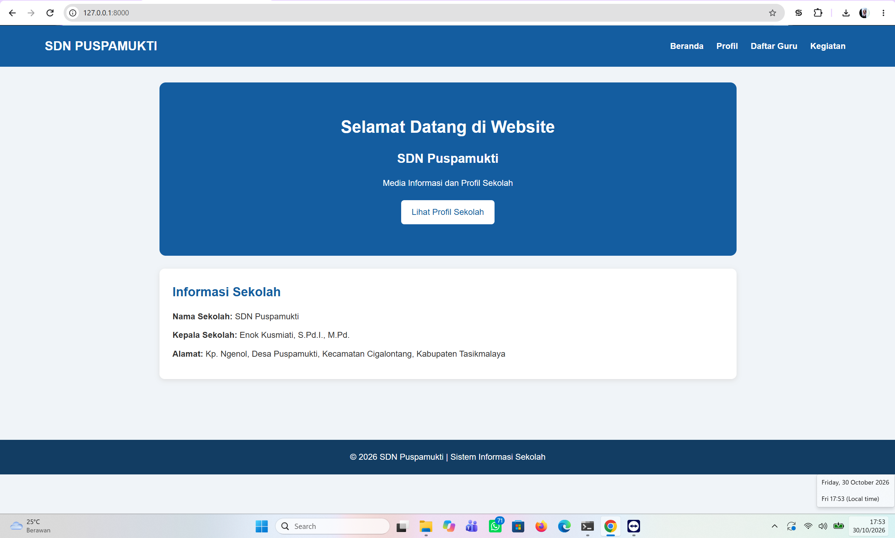
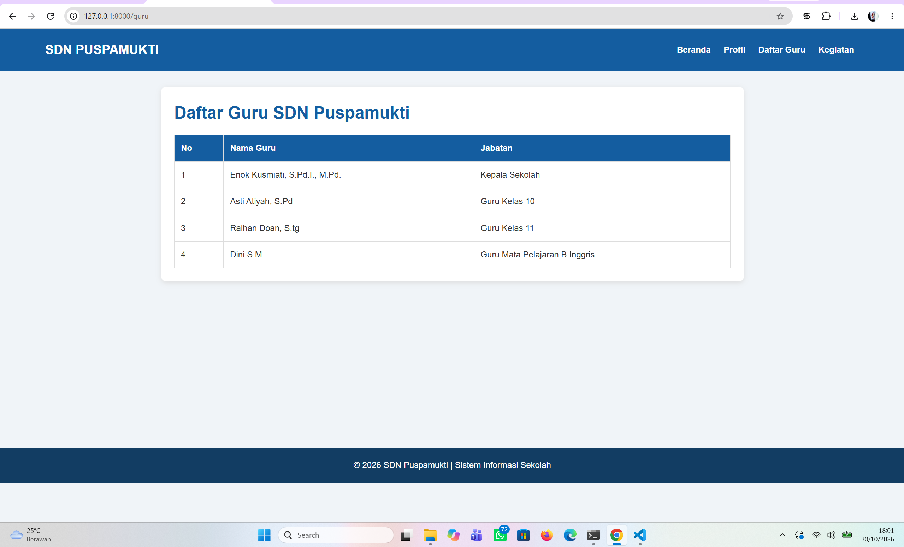
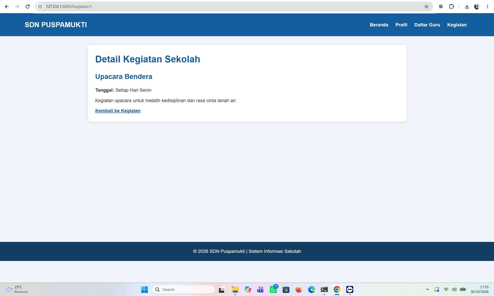

# Praktikum Laravel - Routing dan MVC

**Nama:** Asti Atiyah  
**NIM:** C2483207016  
**Kelas:** PTI5A  
**Program Studi:** Pendidikan Teknologi Informasi  
**Universitas:** Universitas Muhammadiyah Tasikmalaya  

**Tema/Judul:** Sistem Informasi Sekolah SDN Puspamukti

## 1. Deskripsi Aplikasi

Sistem Informasi Sekolah SDN Puspamukti merupakan website sederhana yang dibuat menggunakan framework Laravel. Website ini bertujuan untuk memberikan informasi mengenai profil sekolah, daftar guru, dan kegiatan sekolah.

Website ini memiliki lima halaman utama, yaitu:

1. Beranda
2. Profil Sekolah
3. Daftar Guru
4. Kegiatan
5. Detail Kegiatan

Aplikasi ini menggunakan data statis berupa array PHP yang dikelola melalui Controller dan ditampilkan menggunakan Blade View. Project ini tidak menggunakan database.

## 2. Implementasi Routing, Controller, dan View

### A. Routing

Routing digunakan untuk mengatur alamat URL dan menghubungkan permintaan pengguna dengan method pada Controller.

Route yang digunakan dalam project ini:

| No. | URL | Fungsi |
|---|---|---|
| 1 | `/` | Halaman Beranda |
| 2 | `/profil` | Halaman Profil Sekolah |
| 3 | `/guru` | Halaman Daftar Guru |
| 4 | `/kegiatan` | Halaman Kegiatan |
| 5 | `/kegiatan/{id}` | Halaman Detail Kegiatan |

Seluruh route menggunakan metode GET dan didefinisikan pada file `routes/web.php`.

### B. Controller

Controller berfungsi untuk mengelola data dan menghubungkan data dengan View.

Project ini menggunakan dua Controller:

1. **HomeController**
   - `index()` untuk menampilkan halaman Beranda.
   - `profil()` untuk menampilkan Profil Sekolah.

2. **InformasiController**
   - `guru()` untuk menampilkan Daftar Guru.
   - `kegiatan()` untuk menampilkan Daftar Kegiatan.
   - `detailKegiatan($id)` untuk menampilkan Detail Kegiatan berdasarkan ID.

Data sekolah, guru, dan kegiatan disimpan dalam array PHP pada Controller, kemudian dikirimkan ke View.

### C. View dan Blade

View digunakan untuk menampilkan halaman website kepada pengguna dengan menggunakan Blade Template Laravel.

Implementasi Blade yang digunakan meliputi:

- `@extends` untuk menggunakan layout utama.
- `@section` untuk mengisi bagian konten halaman.
- `@yield` untuk menampilkan bagian konten dari halaman.
- `{{ }}` untuk menampilkan data.
- `@foreach` untuk menampilkan data secara berulang.
- `@if` untuk menampilkan kondisi sesuai kebutuhan.

## 3. Screenshot Aplikasi

Berikut merupakan dokumentasi tampilan website Sistem Informasi Sekolah SDN Puspamukti.

### A. Halaman Beranda



### B. Halaman Daftar Guru



### C. Halaman Detail Kegiatan



## 4. Teknologi yang Digunakan

- PHP
- Laravel
- HTML
- CSS
- Blade Template
- Visual Studio Code

## 5. Cara Menjalankan Proyek

Berikut langkah-langkah untuk menjalankan aplikasi:

1. Pastikan PHP dan Composer sudah terinstal.
2. Clone repository GitHub atau buka folder project.
3. Buka terminal pada folder project.
4. Jalankan perintah berikut:

```bash
composer install
```

5. Salin file `.env.example` menjadi `.env`.
6. Buat application key dengan perintah:

```bash
php artisan key:generate
```

7. Jalankan server Laravel:

```bash
php artisan serve
```

8. Buka browser dan akses alamat:

```text
http://127.0.0.1:8000
```

## 6. Kesimpulan

Melalui praktikum ini, saya dapat memahami penerapan Routing, Controller, dan View menggunakan framework Laravel. Saya juga dapat membuat website sederhana dengan beberapa halaman yang saling terhubung serta menerapkan konsep MVC dalam pengembangan aplikasi web.

---

**Repository GitHub:** [Masukkan URL Repository GitHub]
